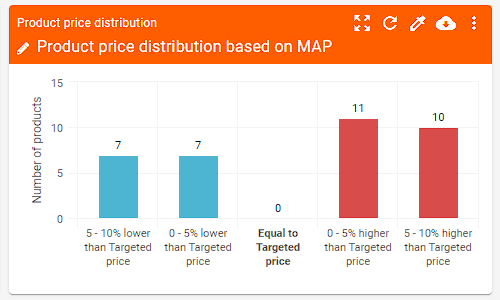
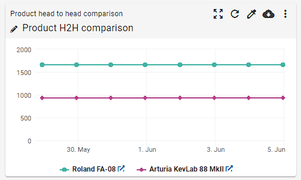
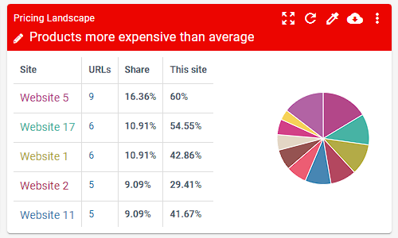
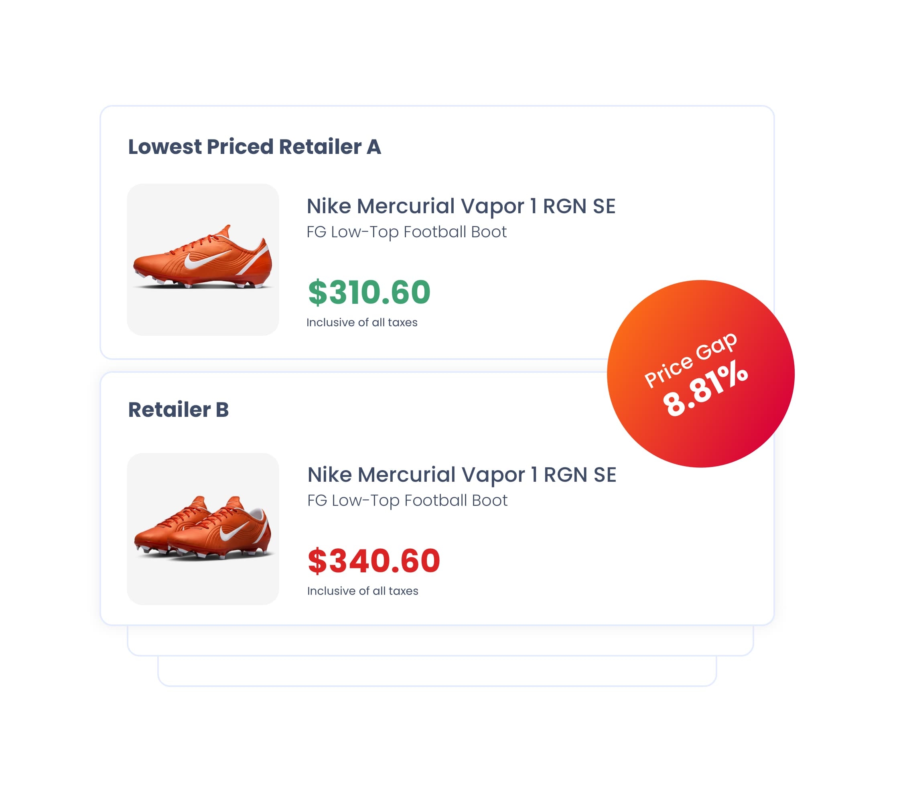
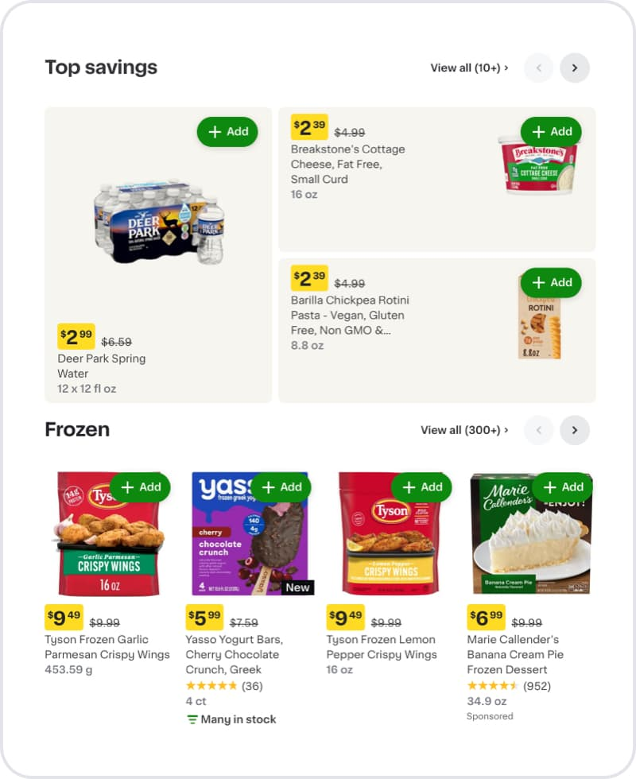

# 单品牌产品阵列 + 竞品价格总览：公开产品参照

**调研日期**：2026-10-18  
**目标**：为 PriceLens 的“一个国家 × 一个产业”总览寻找成熟的页面结构，重点观察单品牌产品线、竞品、价格带、价格变化和 SKU 下钻如何放在同一条业务路径里。  
**来源原则**：优先使用品牌官网或产品厂商自己的产品页；页面中的营销截图只作为布局参照，不把厂商宣称当作独立效果验证。

## 先看图：五张最值得讨论的参考图

以下素材已存到本目录，方便在评审时并排查看。

| 参考 | 画面 | 适合借鉴的部分 |
|---|---|---|
| Price2Spy 产品价格分布 |  | 用价格偏离目标价的区间做横轴，快速回答“有多少产品在目标价上/下”。 |
| Price2Spy 产品 H2H |  | 用多条价格时间线回答“我方与竞品谁在上移、谁在下移”。 |
| Price2Spy Pricing Landscape |  | 用表格给精确数字、图形给整体比例，适合作为总览摘要卡。 |
| DataWeave Price Gap |  | 用单个醒目的价差徽标连接两张零售商/竞品报价卡，突出行动优先级。 |
| DataWeave SKU-level listing |  | 用分区、横向产品卡、促销价/参考价、库存和评分完成从品类到 SKU 的下钻。 |

## 1. Apple：全品牌产品线的“并排比较”

- **官方页面**：[iPhone Compare](https://www.apple.com/iphone/compare/)
- **页面结构**：用户先选择要比较的机型，随后以固定列展示多部 iPhone；规格按行对齐，价格、尺寸、相机、芯片、电池和容量等属性保持同一纵向节奏。Apple 的购买页另有“全系产品细细看”，把产品线按机型卡片呈现，并在卡片上给出“起价”和“进一步了解/购买”。
- **可借鉴**：
  1. 产品线应先建立“同一维度、同一行”的比较骨架，避免每个产品卡片自己决定字段位置。
  2. 价格带和型号明细分成两个层级：第一层给选择和定位，第二层给规格事实。
  3. 选择产品后再进入比较，控制首屏密度；不要把所有 SKU 的全部字段一次性铺开。
- **对 PriceLens 的启示**：总览中的型号卡只保留“定位、当前价区间、配置数、竞品数、生命周期”，把容量/颜色/渠道价等放入下钻表格。Apple 的固定列比较适合型号详情区，不适合直接承担市场地图。

## 2. Samsung：产品目录与价格并列的“可选产品卡”

- **官方页面**：[Samsung Galaxy Compare](https://www.samsung.com/us/smartphones/compare/)、[Explore Galaxy Smartphones](https://www.samsung.com/us/mobile/phones/all-phones/)
- **页面结构**：目录页以产品卡列出 Galaxy S、Z、A 等系列，每张卡同时显示型号、颜色/容量选择、评分、当前价格、Compare、Buy、Learn more。Compare 页把选中的机型放到固定列中，并提供“Show me the differences”和完整技术规格。
- **可借鉴**：
  1. 产品卡有明确的“选入比较”入口，比较不是每行都重复一个大按钮。
  2. 目录视图展示“型号 + 起价 + 系列/配置”，技术细节在比较视图统一对齐。
  3. 同品牌内部系列用产品族来分组，而不是只按价格排序。
- **对 PriceLens 的启示**：在总览首层保留“系列”作为主视觉分组；竞品不要被塞进我司配置行，而应作为同价位/同系列的第二类节点。型号详情再采用固定列对齐字段。

## 3. Price2Spy：目标价分布、竞品时间线和价格景观

- **官方产品页**：[Pricing Dashboard](https://www.price2spy.com/pricing-dashboard.html)
- **官方图片**：
  - [Product price distribution](https://www.price2spy.com/wp-content/uploads/2023/06/Product-price-distribution-widget.png)
  - [Product H2H comparison](https://www.price2spy.com/wp-content/uploads/2023/06/Product-H2H-comparison-widget.png)
  - [Pricing landscape](https://www.price2spy.com/wp-content/uploads/2023/06/Pricing-landscape-widget.png)
- **页面结构**：以可组合的 dashboard widget 组织分析。Product price distribution 用“低于/等于/高于目标价”的价格区间做柱状分布；Product H2H comparison 用时间序列折线对比两个产品；Pricing landscape 用“表格 + 饼图”展示站点/竞品在样本中的份额和高于平均价的比例。
- **可借鉴**：
  1. **价格地图的 Y 轴不要只写价格数字**，还要提供价格区间语义（低于目标、目标附近、高于目标）。
  2. 总览可以同时给“横截面位置”和“纵向趋势”：地图回答现在在哪，趋势线回答怎么变。
  3. 图表标题直接写结论范围（如“高于平均价的产品”），而不是只写“图表”。
  4. 表格与图形成对出现：图形负责扫读，表格负责核对；不要让竞品信息只藏在 tooltip 里。
- **对 PriceLens 的启示**：把“产品摆位图”设计成可切换的价格带画布：Y 轴为当前价（按所选货币），横向按系列或品牌分栏；每个节点显示我司/竞品标识、型号、价格区间。首屏另加一个“我司产品偏离目标价格的分布”摘要卡，避免摆位图承担所有统计。

## 4. DataWeave：价差优先级和 SKU 横向货架

- **官方产品页**：[Pricing Intelligence](https://dataweave.com/pricing-intelligence)
- **官方图片**：
  - [Price gap](https://dataweave.com/assets/images/price-gap-june-2025@2x.jpg)
  - [Granular insights at SKU level](https://dataweave.com/assets/images/granular-insights-sku-level-june-2025.jpg)
- **页面结构**：Price Gap 用上下两张报价卡表示两个零售商，中心叠加一个“Price Gap 8.81%”徽标；SKU-level 画面按“Top savings / Frozen”等区块组织产品卡，每张卡统一展示促销价、参考价、规格、评分、Sponsored/New 和库存信息，并可横向翻页。
- **可借鉴**：
  1. 把最值得动作的差异做成单独徽标（价差、生命周期异常、缺货），不要埋在表格最右侧。
  2. 用区块标题和横向分页控制 SKU 数量，用户先看“这一组有什么”，再看单品。
  3. 价格、参考价、促销和库存在卡片上固定位置，减少扫描成本。
- **对 PriceLens 的启示**：总览顶部可做 3 个“动作摘要”：我司低于主要竞品的型号、我司高于主要竞品的型号、无有效竞品匹配的型号。点击摘要直接过滤摆位图；不要把警告继续放到每个配置行的最右列。

## 5. Competera：竞品价格历史的“图表 + 当前状态表”

- **官方产品页**：[Competitive Data](https://competera.ai/products/competitive-data/)、[Health & Beauty Retail solution](https://competera.ai/solutions/by-industry/health-and-beauty-retail)
- **官方演示图片**：[Price history screenshot](https://competera.ai/hs-fs/hubfs/pages/Solutions/by-industry/health-and-beauty-retail/parfum_price_history_lossless.webp?width=1344&height=996&name=parfum_price_history_lossless.webp)
- **页面结构**：产品详情卡同时放当前价格、库存/促销状态和价格历史折线；折线有我方与多个竞品系列，下面紧接一张对应表，列出名称、价格、周期、库存、促销。页面还提供从产品列表进入单品详情的路径。
- **可借鉴**：
  1. 竞品在图表中和我司同一坐标系，颜色只表达“谁”，不把竞品做成第二张孤立表。
  2. 图表下方必须有当前快照表，解决“趋势看懂了但当前价是多少”的断层。
  3. 库存和促销用状态徽章，避免把“在售/促销”写成长句。
  4. 总览→产品→配置是逐层下钻，而不是在总览里同时打开全部字段。
- **对 PriceLens 的启示**：点击摆位图节点后，右侧或下方出现同一型号的“当前状态 + 近 8 周价格线 + 竞品表”；竞品线用同一价格单位和同一日期窗口。这样竞品是主流程的一部分，而不是“竞品对比”弹窗里的补充内容。

## 6. Minderest 与 Prisync：把产品、竞品、库存和渠道状态放在统一监控面

### Minderest

- **官方产品页**：[Retailers pricing suite](https://minderest.com/retailers)
- **官方图片**：[Competitor price tracking](https://minderest.com/themes/penguin/src/assets/images/industry-retailers/retail-competitor-price-tracking.png)、[Competitor assortment tracking](https://minderest.com/themes/penguin/src/assets/images/industry-retailers/retail-competitor-assortment-tracking.png)
- **页面结构**：价格监控图用一张商品卡配多张竞品/零售商报价卡；assortment tracking 用 SKU、价格、品牌、库存胶囊和在售状态组成可扫描表格。产品页强调从全目录、品牌、品类和价格策略层面看竞品。
- **可借鉴**：
  1. 同一个商品对象下挂多个竞品报价，竞品关系清楚；不要把竞品行混入我司配置行造成层级错乱。
  2. 在售/缺货直接用绿勾、红叉和胶囊标签表达。
  3. 目录级、产品级、报价级有清晰层次，适合从粗粒度下钻到 SKU。

### Prisync

- **官方产品页**：[Price intelligence software](https://www.prisync.com/price-intelligence-software/)、[Ecommerce pricing software](https://prisync.com/ecommerce-pricing-software/)
- **页面结构**：官方定位是把竞品价格、库存、品牌和品类放到一个 dashboard，并提供价格位置比较、历史趋势、变化通知和自动调价规则。其帮助文档说明产品历史视图可以切换日期范围，并按竞品网站显示/隐藏历史价格线。
- **可借鉴**：
  1. 竞品数据需要按渠道/网站可切换，而不是把不同渠道的价格混在一个平均值里。
  2. “当前价格 + 历史趋势 + 库存”是一个完整的产品监控单元。
  3. 价格历史可筛选和导出，便于把总览发现转成复盘证据。

## 归纳：几种结构各自解决什么问题

| 结构 | 最擅长回答 | 对 PriceLens 的用途 |
|---|---|---|
| 品牌目录/并排规格（Apple、Samsung） | 我们有哪些系列/型号，型号之间怎么选 | 第一层产品阵列、第二层固定字段对比 |
| 价格带分布（Price2Spy） | 哪些产品偏离目标价，集中在哪些价格区间 | 总览摘要和 Y 轴价格带 |
| 价格景观（Price2Spy） | 哪些竞品/渠道占比高，整体偏贵还是偏低 | 国家×产业的竞品覆盖摘要 |
| 价差徽标 + 产品卡（DataWeave） | 哪个差异最值得立刻处理 | 首屏动作摘要、节点状态 |
| 同轴价格历史（Competera、Prisync） | 竞品怎么变化，当前价和库存是什么 | 点击节点后的趋势和快照 |
| 目录/货架表（DataWeave、Minderest） | 全部产品/竞品有哪些，可否下钻到 SKU | 产品系列展开后的密集列表 |

## 面向 PriceLens 的推荐方案

### 1. 首屏改成“市场摘要 + 价格摆位图”，不要直接进入配置明细

建议首屏顺序：

1. **范围条**：国家、产业、渠道、货币、数据日期；保留一个紧凑的“只看我司 / 我司 + 竞品 / 只看异常”切换。
2. **市场摘要**：我司系列数、我司型号数、竞品型号数、覆盖价格带、需要关注的价差型号数。
3. **动作摘要**：低于主要竞品、高于主要竞品、竞品缺失/匹配不确定三类；点击即过滤画布。
4. **市场价格摆位图**：Y 轴为当前价，横向按系列分栏；同一型号的我司与竞品节点共享一条水平位置。节点显示品牌色、型号简称、当前价；竞品用灰蓝色，避免与我司主色混淆。
5. **下方才是产品阵列/明细**：按系列分组，默认只展示型号摘要；点击节点或型号才打开配置与竞品快照。

### 2. 竞品应进入摆位图，但要保持三层关系

```
系列（如旗舰 / 高端 / 中端）
  └─ 型号（我司主节点）
       ├─ 竞品型号节点（同价位、同品类、同市场）
       └─ 配置明细（容量、渠道、现价、RRP、库存、时间线）
```

不要把“Samsung / Apple / Honor”直接作为我司配置的平级行；那会再次产生错位。竞品属于型号的比较对象，配置属于型号的明细对象。

### 3. Y 轴采用“连续当前价 + 语义价格带”的双层标注

- 连续刻度保证型号之间的真实距离可读。
- 背景用 5 个可配置价格带（旗舰、高端、中高端、中端、入门），带名来自该国家/产业的实际分布，不硬编码全球统一价位。
- 同一个型号的价格区间用短横线或透明范围带表示，避免只显示一个平均点。
- 竞品节点与我司节点共享坐标轴；悬停/点击显示品牌、型号、当前价、最低/最高配置和数据日期。

### 4. 总览与详情的分工

- **总览**：回答“市场上有哪些产品、各自在哪个价位、竞品是谁、哪里有明显价差”。
- **产品详情**：回答“这个型号每个配置的价格、折扣、RRP、库存、竞品匹配和近 8 周走势”。
- **管理动作**：回答“我应先处理哪几个型号，原因是什么，是否有证据”。

这条路径同时借鉴了 Apple/Samsung 的产品线选择、Price2Spy 的价格分布、Competera/Prisync 的时间线和 DataWeave/Minderest 的状态卡，但不照搬任何一个产品的卡片样式。

## 评审时建议优先决策的三个问题

1. **摆位图横轴**：按我司系列分栏（推荐）还是按品牌分栏？业务诉求是“一个品牌看完整产品线”，因此推荐按我司系列分栏，竞品以节点/短线叠加。
2. **竞品默认显示数量**：每个我司型号默认显示 2–3 个已匹配竞品（推荐），其余收进“更多竞品”；否则真实全区域数据接入后会变成点云。
3. **动作优先级**：默认按价差绝对值排序（推荐）还是按价差百分比排序？建议同时显示绝对值和百分比，但默认按“影响最大的价差”排序，影响可由销量/战略权重加权。

> 注：以上页面和图片是公开产品页的结构参照。厂商展示图可能是演示或营销素材，落地时仍需以 PriceLens 的真实字段、匹配置信度和数据刷新周期为准。
