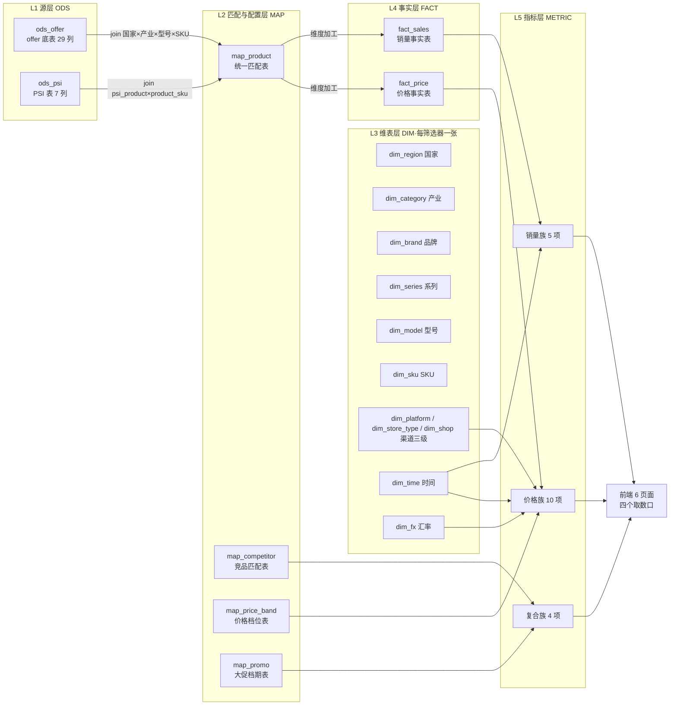
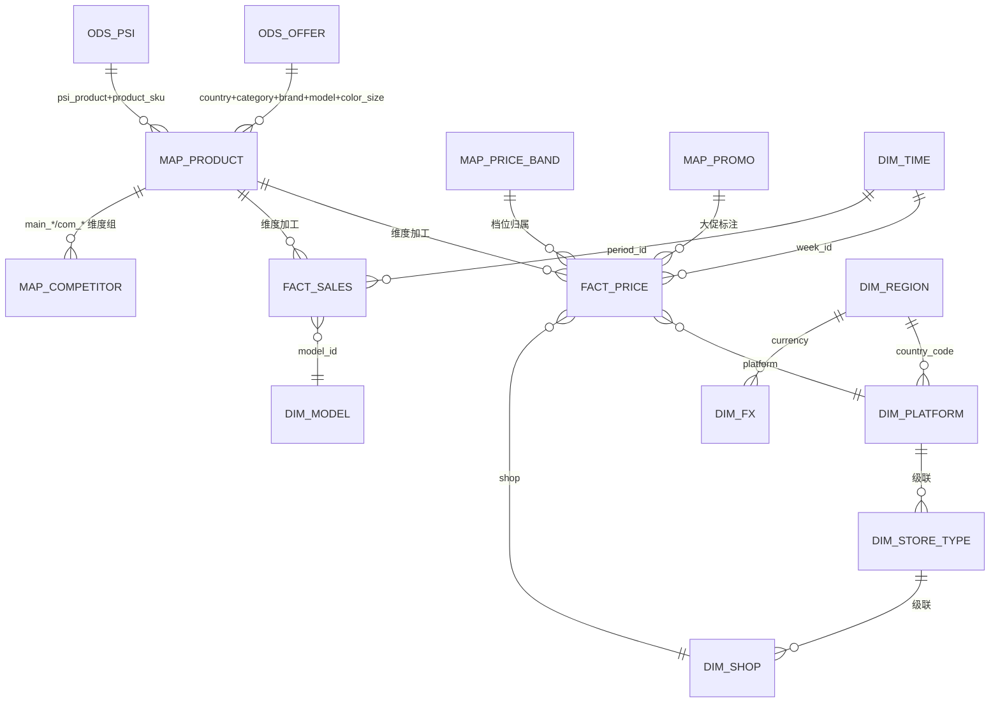

# PriceLens 数据建模方案 · 深层重构（v2，已拍板）

> 2026-11-22。在《数据字典与ER图-2026-11-19》（v1，17 表+1 逻辑表）与《五层架构-2026-11-20》基础上按 Eason 2026-11-22 指令深化。
> **本轮核心变化**：① PSI 源 4 列→7 列（Product/SKU 分列＋管理大区＋PSI Type）；② 统一匹配表（offer/PSI 双侧键＋cat1–4 维度加工）；③ 竞品匹配/价格档位/大促档期三张配置表改版（维度组表达＋is_active/分国分产业显式行）；④ 事实表两族（价格＋销量）由匹配表加工产出；⑤ 每个筛选器一张独立维表；⑥ **指标层全量清单＋前端每个取值位置→指标的映射**。
> 本文档只定建模规格，不改代码；前端四个取数口（`buildSeries` / `volumeByBuckets` / `buildAlerts` / `buildOverviewMatrix`）契约不动，引擎金标（`engineParity.test.ts`）继续钉死。
> 9 国 PSI 样例已固化：`docs/底表样例/PSI-9国产品维度样例-2026-11-22.csv`（2,736 行）。
> **2026-11-22 八项拍板已落定**（§8）：①官方价族=预留字段（到手价口径取平台族）②PSI 周粒度 ③去重按平台族判最低价 ④匹配表增补 4 列采纳 ⑤档位上界开区间＋ref_price 落 dim_model ⑥大促多平台拆行（空=全部）⑦fact_sales 物理化随接入 ⑧大盘接真数优先。现库 offers.csv 本就只有平台价族（24 列），与拍板①自洽。

---

## 1. 六层总览与数据流

**读法**：来源表 × 匹配表 → 两张事实表；事实表 + 维表 → 指标；指标 → 前端取值位置（§6.2 逐位映射）。

### 1.1 v1 → v2 变化一览

| # | v1（2026-11-19） | v2（本文） | 变化性质 |
|---|---|---|---|
| 1 | PSI 源 4 列（country/product 含规格串/periodId/qty） | PSI 源 7 列（Product 与 SKU **分列**＋管理大区＋PSI Type） | 源口径演进（2026-11-22 指令） |
| 2 | map_model＋map_sku＋map_spec_split 三张拆开 | **map_product 统一匹配表**（双侧键＋series/cat1–4/info 一行承载） | 合并重构 |
| 3 | dim_benchmark 950 行 ID 直连（own_model_id→competitor_sku_id） | map_competitor **维度组表达**＋comp_rank＋is_active | 配置表改版 |
| 4 | dim_tier 全局 JSON 阶梯单行 | map_price_band **分国×分产业显式行**（min/max USD 边界） | 配置表改版 |
| 5 | dim_promo（无产业列，depth_hint） | map_promo（**＋category＋platform**，promo_info 吸收深度） | 配置表改版 |
| 6 | dim_channel 渠道一张表 | 拆 **dim_platform / dim_store_type / dim_shop** 三张（对应筛选器三级级联） | 维表拆分 |
| 7 | fact_price_weekly 单价族（rrp/price） | fact_price **官方/平台双价族**（承接 29 列源） | 事实表扩族 |
| 8 | fact_sales_weekly 逻辑表 | **fact_sales 物理化**（join 键=匹配表 Product×SKU 对） | 物理化 |
| 9 | 无指标层定义 | **指标层全量清单＋前端逐位映射**（§6） | 新增 |
| 10 | dim_region/dim_time/dim_fx | 沿用（dim_region 即国家维表） | 不变 |

---

## 2. 来源表方案（ODS 层）

> 表格式：**字段（英文）｜中文名｜类型｜参考值域｜备注**。

### 2.1 offer 底表（街价采集，29 列）

粒度：一行 = 一条采集明细。ODS 原样落库，零派生列；维度加工一律进匹配表（匹配小表原则不变）。

| # | 字段（英文） | 中文名 | 类型 | 参考值域 | 备注 |
|---|---|---|---|---|---|
| 1 | `tech_date` | 采集日期 | TEXT | `2026-11-21` | 采集批次日；**周归属锚**（tech_date→所在 ISO 周周三，见 dim_time） |
| 2 | `category` | 品类 | TEXT | 手机 / 平板 / 穿戴 / 音频（源为英文 phone/tablet/wearable/audio） | 直取；**中文产业由匹配表加工产出**（offer 列仅存原文） |
| 3 | `brand` | 品牌 | TEXT | HUAWEI / Samsung / Apple / Xiaomi…（27 品牌） | `HUAWEI` = 我司；我司/竞品分流锚 |
| 4 | `model` | 型号 | TEXT | 型号名原文（可含品牌词、规格词） | 匹配表归一正名（剥品牌词/规格词） |
| 5 | `color_size` | SKU | TEXT | 颜色＋存储串（`12+512 GB Black`） | 匹配表 offer 侧键②；不预拆 |
| 6 | `platform` | 平台 | TEXT | DNS / OZON / Amazon / Noon / Carrefour… | 渠道筛选第一级 |
| 7 | `country` | 国家 | TEXT | 中/英/两位码均收（俄罗斯/Russia/RU） | 归一到两位码（9 国：SA/AE/PH/MY/MX/BR/RU/DE/PL） |
| 8 | `store_type` | 店铺类型 | TEXT | `1P` / `3P` / `独立站` | 三值封闭；渠道筛选第二级 |
| 9 | `shop_name` | 店铺名称 | TEXT | 卖家店铺原文 | 取证保留 |
| 10 | `shop_name_new` | 店铺名称-归一 | TEXT | 归一显示名 | 展示用；空兜底 `平台 店铺类型`；渠道筛选第三级 |
| 11 | `official_rrp_local` | 官方建议零售价-本币 | REAL | > 0，本币 | **预留字段**（官方价族，拍板①：暂无实际作用） |
| 12 | `official_selling_price_local` | 官方到手价-本币 | REAL | > 0，本币 | **预留字段** |
| 13 | `official_discount_rate` | 官方折扣率 | REAL | −1 ~ 0 负小数 | **预留字段**；源 `-15%`/`-0.15` 统一为负小数 |
| 14 | `platform_rrp_local` | 平台建议零售价-本币 | REAL | > 0，本币 | 平台价族 |
| 15 | `platform_selling_price_local` | 平台到手价-本币 | REAL | > 0，本币 | 平台价族；**到手价指标主口径来源**（待拍板 §9-1） |
| 16 | `platform_discount_rate` | 平台显示折扣率 | REAL | −1 ~ 0 | 页面展示折扣 |
| 17 | `platform_real_discount_rate` | 平台实际折扣率 | REAL | −1 ~ 0 | 实际到手折扣 |
| 18 | `currency` | 货币 | TEXT | ISO 4217（SAR/AED/PHP/MYR/MXN/BRL/RUB/EUR/PLN…） | |
| 19 | `exchange_rate` | 汇率 | REAL | `1 USD = N 本币`，> 0 | 行内汇率；与 dim_fx 交叉校验（倒挂自愈沿用） |
| 20 | `official_rrp_usd` | 官方建议零售价-USD | REAL | > 0 / null | **预留字段**；= local ÷ rate，导入时校验重算 |
| 21 | `official_selling_price_usd` | 官方到手价-USD | REAL | > 0 / null | **预留字段**；同上 |
| 22 | `platform_rrp_usd` | 平台建议零售价-USD | REAL | > 0 / null | 同上 |
| 23 | `platform_selling_price_usd` | 平台到手价-USD | REAL | > 0 | 同上 |
| 24 | `is_bundle` | 是否组合销售 | TEXT | Y / N / TRUE / 是 | 事实表转 0/1 |
| 25 | `installment` | 分期付款 | TEXT | 分期政策原文（期数/免息） | 悬停卡展示；不做数值拆分 |
| 26 | `promotion_details` | 促销详情 | TEXT | offer 综合长文 | 悬停卡全文 |
| 27 | `URL` | 网址链接 | TEXT | https://… | 取证 |
| 28 | `screenshot` | 截图命名 | TEXT | 文件名 | 取证 |
| 29 | `collection_time` | 采集时间 | TEXT | datetime 原文 | **去重排序键**（同键同刻保最低价） |

**源侧必备性**：★ 必备 = 2/3/4/5/6/7/8/14/15/18/19/23/29；○ 强烈建议 = 9/10/11/12/22；其余可缺省（缺省降级规则沿用 v1）。官方价族 5 列（11/12/13/20/21）为**预留字段**，采集侧可不填。

### 2.2 PSI 表（销量，7 列）

粒度：一行 = Product SKU × 周期 × 口径。字段名固定英文（PSI 系统导出原样）。

| # | 字段（英文） | 中文名 | 类型 | 参考值域 | 备注 |
|---|---|---|---|---|---|
| 1 | `Management Region` | 管理大区 | TEXT | 中东非 / 亚太 / 拉美 / 欧洲 / 欧亚 | 国家上卷层；对应 dim_region.region_name |
| 2 | `Management Country/Region` | 国家 | TEXT | 沙特阿拉伯 / 阿联酋 / 菲律宾 / 马来西亚 / 墨西哥 / 巴西 / 俄罗斯 / 德国 / 波兰（首期 9 国） | 归一两位码 |
| 3 | `Product` | 型号 | TEXT | 型号级（`HUAWEI nova 13` / `MatePad 11.5吋 2023`，**不含规格**） | 匹配表 psi_product 键① |
| 4 | `Product SKU` | SKU | TEXT | 含规格/颜色/渠道串（`HUAWEI nova 13 12GB+256GB 星耀黑 双卡 公开渠道版 英规`） | 匹配表 product_sku 键② |
| 5 | `Period ID` | 周期 | TEXT | 周 `YYYY0WW`（`2026043`） | **拍板：周粒度**（2026-11-22）；未来如出现月度口径再扩展 |
| 6 | `PSI Type` | 销量口径 | TEXT | `周度` | **拍板：周粒度**（2026-11-22） |
| 7 | `QTY` | 销量 | REAL | ≥ 0（台） | 同键多行求和；≤0/非法行计 skipped |

**附注**：随本方案附的 9 国样例另带 1 列 category 标注（手机/平板/穿戴/音频），**正式导出 7 列不含**——产业由匹配表按 Product 串拆解产出；该标注列可作为拆解规则预填依据（已入 `docs/底表样例/PSI-9国产品维度样例-2026-11-22.csv`）。

**汇总口径**：QTY 按 `(country, psi_product, product_sku, period_id, psi_type)` 求和；颜色等次级信息**不进**销量 join 键（与 v1 拍板一致）。

### 2.3 9 国 PSI 样例统计（匹配表建设依据）

- 总计 **2,736 SKU 行**；产业分布：穿戴 1,151 / 手机 736 / 音频 461 / 平板 388。
- 国家分布：俄罗斯 427 / 墨西哥 383 / 沙特 348 / 阿联酋 325 / 马来西亚 280 / 德国 285 / 波兰 265 / 菲律宾 260 / 巴西 163。

| 国家 | 手机型号数 | 平板 | 穿戴 | 音频 |
|---|---|---|---|---|
| 俄罗斯 | 39 | 17 | 38 | 17 |
| 墨西哥 | 30 | 16 | 34 | 17 |
| 德国 | 14 | 15 | 41 | 19 |
| 沙特阿拉伯 | 32 | 19 | 33 | 19 |
| 波兰 | 17 | 14 | 40 | 15 |
| 菲律宾 | 29 | 15 | 29 | 14 |
| 阿联酋 | 29 | 18 | 35 | 19 |
| 马来西亚 | 26 | 15 | 36 | 17 |
| 巴西 | 7 | 4 | 26 | 15 |

- 系列值域（category/series 列的实测支撑）：手机 = Pura / Mate / Mate X / nova；平板 = MatePad / MatePad Air / MatePad Pro / MatePad SE / MatePad Mini；穿戴 = WATCH / Band / 手环 / 超新星 / HONMA 联名 / Scale；音频 = FreeBuds / FreeClip / FreeLace / FreeArc / Eyewear。
- 平板柔光/非柔光（category3）：188 / 200——**有真实拆分价值**。
- 手机规格 top：12+512(215) / 8+256(168) / 12+256(147) / 16+512(93) / 8+128(57) / 16+1TB(20)…
- **关键证据**：336/2,736 行（12%）的 Product SKU **不含** Product 前缀（如 Product=`MatePad 11.5吋 2023`、SKU=`HUAWEI MatePad 柔光版 WIFI 8GB+256GB…` 省略型号词；`Telcel版`/`英规` 等渠道差随国变化）→ 匹配表必须按 **(psi_product × product_sku) 对**半自动预填＋人工核对，**不能靠前缀推导**。

---

## 3. 匹配与配置层（MAP 层）

> 表格式：**字段（英文）｜中文名｜来源｜规则｜参考值域｜类型｜备注**（竞品匹配表另有关联列）。

### 3.1 统一匹配表 map_product（核心）

**目的**：把 offer 和 PSI 两表维度匹配上，并加工成前台需要的样子。一行 = 一条产品身份映射记录。

| 字段（英文） | 中文名 | 来源 | 规则 | 参考值域 | 类型 | 备注 |
|---|---|---|---|---|---|---|
| `country` | 国家 | offer 底表 | 直取 | SA/AE/PH/MY/MX/BR/RU/DE/PL | TEXT | **匹配按国家隔离**：同型号 PSI SKU 串因充电规（英规/美规/俄规）/渠道版（Telcel版）异国不同 |
| `category` | 产业 | offer 底表 | 加工 | 平板 / 穿戴 / 手机 / 音频 | TEXT | 英文品类翻译为中文；PSI 侧产品由拆解规则补（样例标注列佐证） |
| `brand` | 品牌 | offer 底表 | 直取 | HUAWEI / 27 竞品品牌 | TEXT | |
| `model` | 型号 | offer 底表 | 直取 | 型号正名（归一剥品牌词） | TEXT | **offer 侧 join 键①**；即 v1 map_model.model_name |
| `color_size` | SKU | offer 底表 | 直取 | 颜色＋存储串 | TEXT | **offer 侧 join 键②** |
| `series` | 系列 | 手工 | 规则预填＋人工核对 | Pura / Mate / Mate X / nova / MatePad* / WATCH* / Band / 手环 / 超新星 / FreeBuds* / FreeClip / FreeLace / FreeArc / Eyewear / Scale / HONMA | TEXT | 产业页签上卷维度；值域见 §2.3 实测 |
| `category1` | 规格 | 手工 | 规格拆解 | `12+256 GB`；`41mm` | TEXT | 手机=存储；穿戴=表盘尺寸；平板=存储；音频=空 |
| `category2` | 尺寸 | 手工 | 尺寸拆解 | `11.5"`；`12.2"`；`13.2"`；`10.36"`；`8.8"` | TEXT | 平板专用；其余产业空 |
| `category3` | 柔光/非柔光 | 手工 | 特殊屏词识别 | `PaperMatte`；`Normal` | TEXT | **平板销量按柔光拆分口径**；非平板空；实测 188/200 |
| `category4` | 预留字段 | 手工 | 预留 | 恒空 | TEXT | 未来新维度占位，建表即含列 |
| `info` | 详细信息 | 手工 | 次级信息拆解 | 颜色等 | TEXT | 颜色/联网(WIFI/LTE)/表带材质/键盘语言/渠道版本(公开渠道版/Telcel版/AT&T版)/充电规；**不进**销量 join 键 |
| `psi_product` | 型号 | PSI | 直取 | `HUAWEI nova 13` | TEXT | **PSI 侧 join 键①** |
| `product_sku` | SKU | PSI | 直取 | `HUAWEI nova 13 12GB+256GB 星耀黑 双卡 公开渠道版 英规` | TEXT | **PSI 侧 join 键②** |
| `is_active` | 生效位 | 手工 | 1 生效 / 0 停用 | 1 / 0 | INTEGER | **拍板④采纳**：停用不下架历史配置（与竞品匹配表对齐） |
| `match_status` | 匹配状态 | 加工 | matched / offer_only / psi_only | 三值封闭 | TEXT | PSI 新 SKU 到货先挂 psi_only 待匹配 |
| `updated_at` | 更新时间 | 加工 | `YYYY-MM-DD` | | TEXT | 维护留痕 |
| `maintainer` | 维护人 | 手工 | | | TEXT | 维护留痕 |

**粒度与规模**：一行 = 国家 × 产业 ×（offer 侧 型号×SKU）↔（PSI 侧 psi_product×product_sku）的一条匹配对；同型号 SKU 跨平台/店铺共享一行。规模预估 ≈ 9 国 × 2,736 PSI SKU（offer 侧无对应 SKU 的行按 psi_only 挂起）。

**两侧 join 方向**：
- 价格事实 ← `ods_offer ON (country, category, brand, model, color_size)`
- 销量事实 ← `ods_psi ON (psi_product, product_sku)`

**加工工作流（半自动）**：PSI 新 SKU 进场 → 拆解规则自动预填 series/category1–4/info（沿用 v1 按品类拆列规则：phone=存储+颜色；tablet=尺寸/联网/存储/柔光；wearable=表盘mm+联网+材质+颜色；audio=充电方式+颜色）→ 未命中挂人工队列 → 核对入表。§2.3 的 336 行非前缀案例即人工核对工作量依据。

**增补 4 列已拍板采纳（2026-11-22）**：`is_active` / `match_status` / `updated_at` / `maintainer` 已入上表——PSI 新 SKU 到货先挂 psi_only 待匹配，运营闭环必需位。

### 3.2 竞品匹配表 map_competitor

一行 = 国家 × 品类 × 我司维度组 × 竞品维度组 × 排序。

| 字段（英文） | 中文名 | 来源 | 关联 | 规则 | 参考值域 | 类型 | 备注 |
|---|---|---|---|---|---|---|---|
| `country` | 国家 | 用户补录 | → dim_region | | 9 国 | TEXT | |
| `category` | 品类 | 用户补录 | → dim_category | | 平板/穿戴/手机/音频 | TEXT | |
| `main_brand` | 我司品牌 | 用户补录 | → dim_brand | | 华为产品 | TEXT | |
| `main_series` | 我司系列 | 用户补录 | → map_product.series | | Pura/Mate/nova… | TEXT | |
| `main_category1` | 我司规格 | 用户补录 | → map_product.category1 | 规格 | `12+256 GB` | TEXT | **空串 = 不限**（沿用 v1 own_romram 语义） |
| `main_category2` | 我司尺寸 | 用户补录 | → map_product.category2 | 尺寸 | `11.5"` | TEXT | |
| `main_category3` | 我司柔光 | 用户补录 | → map_product.category3 | 柔光/非柔光 | PaperMatte / Normal | TEXT | |
| `main_category4` | 我司预留 | 用户补录 | → map_product.category4 | 预留 | 恒空 | TEXT | |
| `com_brand` | 竞品品牌 | 用户补录 | → dim_brand | | Samsung/Apple/… | TEXT | |
| `com_series` | 竞品系列 | 用户补录 | — | | Galaxy/iPad… | TEXT | |
| `com_product` | 竞品型号 | 用户补录 | → offer 采价 model | | 需在采价 SKU 内存在才可比价 | TEXT | |
| `com_category1` | 竞品规格 | 用户补录 | → 采价 SKU 规格拆解 | | `8+128 GB` | TEXT | |
| `com_category2` | 竞品尺寸 | 用户补录 | → 采价 SKU | | `11"` | TEXT | |
| `com_category3` | 竞品柔光 | 用户补录 | → 采价 SKU | | PaperMatte/Normal | TEXT | |
| `com_category4` | 竞品预留 | 用户补录 | — | | 恒空 | TEXT | |
| `comp_rank` | 竞品排序/优先级 | 用户补录 | — | | 1 = 首选 | INTEGER | 对比区顺序（沿用 v1 sort） |
| `is_active` | 生效位 | 用户补录 | — | | 1 生效 / 0 停用 | INTEGER | **停用不下架历史配置**（软停用） |

**与 v1 dim_benchmark（950 行）的关系**：v1 用 ID 直连（own_model_id＋own_romram → competitor_sku_id），v2 改**维度组表达**——同组多竞品、人工层按组覆盖矩阵的现行拍板语义天然保留。迁移：`own_romram → main_category1`；`competitor_sku_id → (com_product, com_category1, …)` 反查采价 SKU 拆解展开。人工快照只覆盖显式组、其余随矩阵的规则不变。

### 3.3 价格档位表 map_price_band

一行 = 国家 × 产业 × 档位。

| 字段（英文） | 中文名 | 来源 | 规则 | 参考值域 | 类型 | 备注 |
|---|---|---|---|---|---|---|
| `country` | 国家 | offer 底表 | 只取 | 9 国两位码 | TEXT | |
| `category` | 产业 | offer 底表 | 只取 | 平板/穿戴/手机/音频 | TEXT | |
| `price_band` | 档位标签 | 手工 | 展示用价格区间名称，按 USD 划分 | `$50-$100` | TEXT | 图表档位带/筛选器标签 |
| `band_sort` | 档位排序 | 手工 | 按价格从低到高编号 | 1, 2, 3… | INTEGER | 轴序与筛选器顺序 |
| `max_price` | 价格上限 | 手工 | 当前档位最高价格边界（USD） | 100 | REAL | **上界开区间**（min ≤ 价 < max）；顶档 max 可空 = ∞ |
| `min_price` | 价格下限 | 手工 | 当前档位最低价格边界（USD） | 50 | REAL | |

**两用途**：① 筛选器（档位，价格走势/总览/大盘档位带）；② 落档派生（型号参考价/现价按 `min ≤ USD 价 < max` 落档，band_sort 出轴序）。**与 v1 dim_tier（全局 JSON 阶梯单行）的替换**：v2 分国分产业显式行、边界可直接维护；v1 的 `tier_by_country` 分国档位语义被行粒度天然覆盖。

### 3.4 大促档期表 map_promo

一行 = 国家 × 产业 × 平台 × 起止。

| 字段（英文） | 中文名 | 来源 | 规则 | 参考值域 | 类型 | 备注 |
|---|---|---|---|---|---|---|
| `country` | 国家 | offer 底表 | 只取 | 9 国两位码 | TEXT | |
| `category` | 产业 | offer 底表 | 只取 | 平板/穿戴/手机/音频 | TEXT | **v1 无此列**——同国不同产业档期不同，拆行表达 |
| `platform` | 平台 | offer 底表 | 只取 | DNS/Amazon/OZON…；空 = 全部平台 | TEXT | 锚定单平台填平台名；空/`全部` = 全平台 |
| `start_date` | 开始时间 | 手工 | 大促活动生效起始日期（含当天） | `YYYY-MM-DD` | TEXT | |
| `end_date` | 结束时间 | 手工 | 大促活动结束日期（含当天） | `YYYY-MM-DD`，> start_date | TEXT | |
| `promo_info` | 大促信息 | 手工 | 活动节点名称或促销主题描述 | 双11 / 黑五 / Prime Day；深/中/浅 | TEXT | 用于图表/明细标注；**v1 depth_hint 并入本列** |

**与 v1 dim_promo（66 行）的迁移**：v1 一行（country×promo×起止＋platforms JSON）；v2 拆行（同档期跨产业/多平台各一行），platforms JSON 语义改为行表达。

---

## 4. 事实层（FACT 层）

> 表格式：**字段（英文）｜中文名｜类型｜参考值域｜来源｜备注**。

### 4.1 价格事实表 fact_price

**粒度**：一行 = 周 × 国家 × 平台 × 店铺类型 × 店铺 × 型号 × SKU（= 一条采集去重明细）。
**去重规则**（延续 v1 引擎＋拍板③）：同键同采集时间保留最低价（最低价按**平台族** `platform_selling_price_local` 判定）、有价行优先；`usd = local ÷ rate` 校验重算；单位错位修正与 `>20,000 USD` 护栏沿用。

| 字段（英文） | 中文名 | 类型 | 参考值域 | 来源 | 备注 |
|---|---|---|---|---|---|
| `week_id` | 周 ID | TEXT | `YYYYWW` | tech_date → 周三锚 | FK → dim_time |
| `country_code` | 国家码 | TEXT | 两位大写 | ods_offer.country 归一 | FK → dim_region |
| `category` | 产业 | TEXT | 中文四产业 | map_product 加工 | join 产出，不重复手填 |
| `brand` | 品牌 | TEXT | 27 品牌 | map_product | |
| `model_id` | 型号 ID | TEXT | `own-huawei-…` / `cmp-…` | map_product 归一 | 稳定键契约沿用 v1 |
| `sku_id` | SKU ID | TEXT | `model_id__rom_key__color_key` | map_product | 字节稳定契约（维度退化不改键） |
| `platform` | 平台 | TEXT | 归一平台名 | ods_offer.platform | FK → dim_platform |
| `store_type` | 店铺类型 | TEXT | 1P/3P/独立站 | ods_offer | FK → dim_store_type |
| `shop` | 店铺 | TEXT | shop_name_new | ods_offer | FK → dim_shop；缺省 `—` |
| `official_rrp_local` / `_usd` | 官方建议零售价（本币/USD） | REAL | > 0 / null | ods_offer | 官方价族 |
| `official_selling_price_local` / `_usd` | 官方到手价（本币/USD） | REAL | > 0 / null | ods_offer | 官方价族 |
| `platform_rrp_local` / `_usd` | 平台建议零售价（本币/USD） | REAL | > 0 / null | ods_offer | 平台价族 |
| `platform_selling_price_local` / `_usd` | 平台到手价（本币/USD） | REAL | > 0 | ods_offer | 平台价族；到手价指标主口径 |
| `official_discount_rate` | 官方折扣率 | REAL | −1~0 | ods_offer | |
| `platform_discount_rate` | 平台显示折扣率 | REAL | −1~0 | ods_offer | |
| `platform_real_discount_rate` | 平台实际折扣率 | REAL | −1~0 | ods_offer | |
| `currency` | 货币 | TEXT | ISO 4217 | ods_offer | |
| `exchange_rate` | 汇率 | REAL | > 0 | ods_offer | 与 dim_fx 交叉校验 |
| `is_bundle` | 组合销售 | INTEGER | 0/1 | ods_offer.is_bundle | Y/N/TRUE/是 → 1 |
| `installment` | 分期政策 | TEXT | 原文 / null | ods_offer | |
| `promotion_details` | 促销详情 | TEXT | 原文 / null | ods_offer | |
| `url` | 取证链接 | TEXT | URL / '' | ods_offer | |
| `screenshot` | 取证截图 | TEXT | 文件名 / '' | ods_offer | |
| `collection_time` | 采集时间 | TEXT | datetime | ods_offer | 去重排序键 |

**与 v1 fact_price_weekly 的差别**：v1 单价族（rrp_local/price_local 19 列）；v2 承接 29 列源的双价族全量。v1 的「折叠视图」语义（每 SKU 渠道内最低价）转为**指标层物化**（§6 m1），事实表保留明细去重行——明细证据仍在 ods_offer，双写不丢。

### 4.2 销量事实表 fact_sales（本轮物理化）

**粒度**：一行 = 周期 × 口径 × 国家 × 型号 × SKU。

| 字段（英文） | 中文名 | 类型 | 参考值域 | 来源 | 备注 |
|---|---|---|---|---|---|
| `period_id` | 周期 | TEXT | `YYYY0WW` 周 / `YYYYMM` 月 | ods_psi.Period ID | FK → dim_time |
| `psi_type` | 销量口径 | TEXT | `周度` | ods_psi.PSI Type | **拍板：周粒度** |
| `country_code` | 国家码 | TEXT | 两位大写 | ods_psi 归一 | FK → dim_region |
| `category` | 产业 | TEXT | 中文四产业 | map_product 加工 | |
| `brand` | 品牌 | TEXT | HUAWEI（首期我司） | map_product | |
| `model_id` | 型号 ID | TEXT | → dim_model | map_product | join 键=匹配表对反查 |
| `series` | 系列 | TEXT | §2.3 值域 | map_product | |
| `category1` | 规格 | TEXT | `12+256 GB`；`41mm` | map_product | |
| `category2` | 尺寸 | TEXT | `11.5"` 等 | map_product | 平板 |
| `category3` | 柔光/非柔光 | TEXT | PaperMatte/Normal | map_product | 平板拆分口径 |
| `category4` | 预留 | TEXT | 恒空 | map_product | |
| `product_sku` | SKU（PSI 原串） | TEXT | → map_product.product_sku | ods_psi | 追溯键 |
| `qty` | 销量 | REAL | ≥ 0（台） | ods_psi.QTY | 同键求和 |

**口径规则**（延续 v1 拍板＋本轮新增）：
1. 型号×国家存在任何真实销量行 → 该型号该国整模型走真实销量，不与估算混（v1 拍板保留；两口径不混算）。
2. 型号级销量 = ΣSKU；SKU 级保留（category1–3 键随行）。
   QTY ≤ 0 或非法的源行不进事实（剔除并计数：`psiNonPositiveQty` / 非法值 skipped；原样层 ods_psi 仍保留原行）。
3. **平板销量可按 category3 柔光/非柔光拆分**（category3 进事实维度，Eason 注明用途）。
4. **周粒度**（拍板②）：当前仅周口径；未来如出现月度口径由 psi_type 扩展，不做周摊。

---

## 5. 维表层（DIM 层）——每个筛选器一张

| 维表 | 粒度（一行 =） | 对应筛选器 / 用途 | 与 v1 关系 |
|---|---|---|---|
| `dim_region` | 一个国家 | **国家选择器**（页头 CountryBox，全站唯一入口） | 沿用 v1 |
| `dim_category` | 一个产业 | **产业筛选器**（ScopeFields） | 新增（v1 在 C3-4 字典＋map_model.industry） |
| `dim_brand` | 一个品牌 | **品牌筛选**（对比区/大盘品牌份额） | 新增 |
| `dim_series` | 产业×系列 | **系列分组**（产业页签下钻） | 新增（v1 在 map_model.series） |
| `dim_model` | 一个型号 | **选品器**（ProductBox / mains 主分析卡） | = v1 map_model 维表化 |
| `dim_sku` | 型号×规格×颜色 | **SKU 级呈现**（明细卡/颜色级现价） | = v1 map_sku ＋ 带入 cat2/cat3/info |
| `dim_platform` | 国家×平台 | **渠道筛选第一级**（ChannelScopeBox） | v1 dim_channel 拆分 |
| `dim_store_type` | 店铺类型（1P/3P/独立站） | **渠道筛选第二级** | v1 dim_channel 拆分 |
| `dim_shop` | 国家×平台×店铺类型×店铺 | **渠道筛选第三级**（店铺） | v1 dim_channel 拆分（channel_id 组合键保留） |
| `dim_time` | 一周（周三锚） | **时间筛选器 / 粒度切换**（week/month/quarter） | 沿用 v1 |
| `dim_fx` | 币种×月 | **币种切换**（CurrencyBox local↔USD） | 沿用 v1；新增与 offer 行内 exchange_rate 交叉校验 |

> 配置型「维表」（档位筛选、大促标注、竞品对比）即 §3 的 map_price_band / map_promo / map_competitor——它们同时服务筛选器与指标加工，不再单列。

**dim_model 建议增补**（拍板 §9-5）：`ref_price_usd`（上市参考价，v1 在 map_tier；总览「上市价」取值位置依赖）——挂型号属性，不进匹配表。

各维表字段沿用 v1 对应表（dim_region 10 列 / dim_time 5 列 / dim_fx 3 列 / map_model 6 列 / map_sku 6 列 / dim_channel 6 列拆三），新增 dim_category（`category_code`/`category_en`/`sort`/`enabled`）、dim_brand（`brand`/`brand_slug`/`is_own`/`sort`）、dim_series（`series`/`industry`/`sort`）、dim_platform（`platform`/`country_code`/`sort`/`is_core`）、dim_store_type（`store_type`/`sort`）、dim_shop（`shop_key`/`shop_name`/`shop_name_new`/`country_code`/`platform`/`store_type`）均为 4–6 列小表，值域即来源 distinct。

---

## 6. 指标层（METRIC 层）

> 指标 = 事实表 × 维表加工的最后产物，**前端只消费指标，不直连事实表**。物理上指标层 = 前端现有四个取数口的物化定义（契约不动）：`buildSeries`（价格族）· `volumeByBuckets`（销量族）· `buildAlerts`（预警规则）· `buildOverviewMatrix`（总览矩阵）。

### 6.1 指标清单

**价格族**（来源：fact_price ＋ dim_platform/store_type/shop ＋ dim_time ＋ dim_fx ＋ map_price_band）

| # | 指标（英文） | 中文名 | 计算公式 | 粒度 | 备注 |
|---|---|---|---|---|---|
| m1 | `price_min_sku_avg` | 到手价（折后价） | 选中渠道范围内每 SKU **最低在架成交价**，跨颜色 SKU 平均；月/季=窗口 avg/min | 周×国家×型号 | 前端主价格线口径，v1 延续；价族=**平台到手价**（拍板①） |
| m2 | `rrp` | 建议零售价 RRP | 周 = 最低价行所属 RRP；月/季 = 桶内**最后有值周**的最低价行 RRP（阶梯语义，不是月均） | 周×国家×型号 | RRP 虚线/折扣率分母 |
| m3 | `discount_rate` | 折扣率 | price ÷ rrp − 1 | 周×国家×型号 | 负小数 |
| m4 | `price_spread_platform` | 平台价差 | 同周同型号各平台 m1 极差 | 周×国家×型号 | 仅我司品牌 |
| m5 | `price_range` | 价格极差 | 窗口内 m1 max − min | 窗口×选区 | 极差卡/区间摘要 |
| m6 | `price_band_of` | 档位归属 | `min ≤ USD 价 < max` → price_band（band_sort 轴序） | 型号/周价 | map_price_band 落档 |
| m7 | `official_price` | 官方价族（预留） | official_selling_price_usd 同 m1 口径 | 周×国家×型号 | **预留字段，暂无实际作用（拍板①）**；未来启用再挂指标 |
| m8 | `price_change_pct` | 环比（调价幅度） | (本期 m1 − 上一期 m1) ÷ 上一期 m1 | 周/月×国家×型号 | 明细卡环比胶囊对上一可信桶；调价预警对上一可信**有值**周（两处「上一期」口径不同） |
| m9 | `shop_count` | 在架店铺数 | 窗口内有效价格行 distinct(shop) | 周×国家×型号 | 渠道覆盖广度（新增，可选） |
| m10 | `recent_change` | 近 4 周环比 | **最近 4 个自然周均值 vs 前 4 个自然周均值**；缺价周、隔离周不进均值；任一窗口无值 = 空 | 窗口末周 t（回溯 8 周） | 宽表近4周环比（恒按周，月/季视图取窗口末周回溯）。2026-11-23 代码实读纠错：原写「末 4 有值周首尾变化」有误 |

**销量族**（来源：fact_sales ＋ dim_time ＋ dim_region）

| # | 指标（英文） | 中文名 | 计算公式 | 粒度 | 备注 |
|---|---|---|---|---|---|
| m11 | `qty` | 销量 | Σqty（SKU 级求和到型号级） | 周(或月)×国家×型号 | 真实优先，型号无行回落估算（两口径不混） |
| m12 | `qty_share_model` | 型号份额 | 型号 qty ÷ 产业 Σqty | 周/月×国家 | 接真数后供大盘 |
| m13 | `qty_share_brand` | 品牌份额 | 品牌 Σqty ÷ 产业 Σqty | 月×国家 | 大盘品牌份额线 |
| m14 | `qty_mom` | 销量环比 | 本期 ÷ 上期 − 1 | 周/月×国家×型号 | 销量侧预留（前端暂无取值位；明细卡环比胶囊是价格环比 = m8） |
| m15 | `qty_by_cat3` | 柔光/非柔光销量 | Σqty group by category3 | 周/月×国家×型号（平板） | 平板专用拆分 |

**复合族**（跨事实＋配置表）

| # | 指标（英文） | 中文名 | 计算公式 | 粒度 | 备注 |
|---|---|---|---|---|---|
| m16 | `competitor_price_gap` | 竞品价差 | 价差额 = 竞品价 − 我司价；**百分比的分母两处不统一**：宽表 = ÷ 主品价（diffModel.ts「(行−列)/列」），Agent 价格优势卡 = ÷ 竞品价（priceAdvantage.ts）——定义指标时须指定分母（映射方案待拍板 Q14） | 周×国家×组 | map_competitor 关联，comp_rank 序，is_active=1 才参与 |
| m17 | `promo_flag` | 大促标识 | 周窗口 ∩ map_promo(start,end,country,category,platform) | 周×国家×产业 | 图表带/标注 |
| m18 | `fx_conv` | 币种折算 | local ÷ exchange_rate（行内）与 dim_fx 双校验 | 行级 | 币种切换 |
| m19 | `tier_gap` | 档位间距 | 同型号相邻 category1 档 m1 现价间距 | 型号级 | 预警 own-gap |

### 6.2 前端取值位置 → 指标映射（逐页面）

> 依据前端取数面盘点（文件路径为当前代码）。**真实数据页 5 个**（总览/价格走势/量价走势/预警/Agent），大盘/预测/定价推演/情报中心当前为演示数据——本节同时给出接真数后的指标路径。

**① 总览页**（`pages/Overview.tsx`，取数口 `buildOverviewMatrix`）

| 取值位置 | 消费指标 | 口径说明 |
|---|---|---|
| 档位×型号矩阵行「现价」 | m1（latest 有值周） | |
| 矩阵行「RRP」 | m2（latest） | |
| 矩阵行「折扣率」 | m3 | |
| 迷你走势 spark | m1 时序 | |
| 颜色级现价 | m1（SKU 级） | |
| 竞品行（comps） | m16（竞品 m1/m2/m3，comp_rank=1 为 primary） | |
| 档位带背景 | m6 | map_price_band |
| 型号卡「档位」 | m6（型号参考价落档） | |
| 型号卡「上市价」 | dim_model.ref_price_usd（§9-5） | |
| 生命周期进度 | m1 首末有值周差 | 派生 |

**② 价格走势页**（`chart/PriceTrend/*`，取数口 `buildSeries`）

| 取值位置 | 消费指标 | 口径说明 |
|---|---|---|
| 主图价格线 | m1 | priceTypes.discounted |
| 主图 RRP 虚线 | m2 | priceTypes.rrp |
| 摘要条 PriceSummary | m1/m2/m3（窗口最新有值点） | |
| 销量柱叠加（开关） | m11 | volumeByBuckets，真实 PSI 优先 |
| 大促档期带 | m17 | map_promo ∩ 窗口 |
| 档位带（可开关） | m6 | |
| offer 徽章/弹卡 | 事实明细（installment / promotion_details / is_bundle） | 直读 fact_price 证据列 |
| 多平台对比子视图 | m1（渠道级：平台/店铺/卖家线） | |
| 价差列（宽表） | m16 | (对比品 − 主品) ÷ 主品 |
| 近 4 周环比（宽表） | m10 | 恒按周：月/季视图下取窗口末周回溯 4 周；用取整后的周价计算（映射方案 Q13） |
| ZA 月度分期口径 | fact_price_monthly（v1 保留：finance i24/t24/i36/i48） | marketProfile 切换 |
| Y 轴/时间筛选/币种 | dim_time / dim_fx / m18 | |

**③ 量价走势页**（`pages/VolumePrice.tsx + pages/volume/*`）

| 取值位置 | 消费指标 | 口径说明 |
|---|---|---|
| 每面板价格线 | m1 | |
| 销量柱 | m11 | |
| 单周明细卡 | m1＋m2 删除线＋**m8** 环比胶囊（对上一可信桶；上一桶缺采 = 空）＋m11 | 2026-11-23 纠错：环比胶囊是 m8，原误写 m10 |
| 销毛/成本（开关） | **模拟**（marginCostOf 模拟成本，非事实） | 接真成本属未来项 |
| 极差卡（组视图） | m5 | |
| 合并单图 | m1＋m11 | |
| 库存 DOS 卡 | 演示（inventoryDemo） | 非事实 |

**④ 预警页**（`dataModel/alerts.ts`，取数口 `buildAlerts`）

| 取值位置 | 消费指标 | 口径说明 |
|---|---|---|
| 调价预警 price-change | m8 ≥ 阈值 | |
| 折扣预警 promo | m3 变化幅度（promoDeltaPp） | |
| 平台价差 platform-gap | m4 | 仅我司 |
| 档位间距 own-gap | m19 | 型号级 |
| 事件流 vsRrpPct | m3 | |

**⑤ Agent 面板**（`agent/priceAdvantage.ts`，取数口同 buildSeries）

| 取值位置 | 消费指标 | 口径说明 |
|---|---|---|
| 价格优势卡 | m16（价差 = 竞品价 − 我司价；百分比 = 价差 ÷ **竞品价**；按国家 × 渠道 × 周对齐） | 与宽表分母不同（Q14） |
| 渠道建议 | m1（渠道级 pricedChannelIds） | |

**⑥ 大盘页**（当前全静态 `marketboard/marketBoardData.ts`——接真数路径）

| 取值位置 | 接真数后指标 | 现状 |
|---|---|---|
| 卡①档位品牌份额（段内份额） | m13 × m6（档位分桶） | 模拟 |
| 卡②品牌份额趋势（销量线/均价线/份额堆叠/自定义价带容量） | m13 时序＋m1 加权均价＋m12 | 模拟 |
| 卡③份额走势多线 | m13 | 模拟 |
| 卡④品牌档位同比 | m13 YoY | 模拟 |

**⑦ 量价预测页**（当前 fixture）——主图实际段 = m11＋m1；参考卡 = m11 上一代（上一代关系配置）；库存/销毛卡 = 模型推演（非事实）。**⑧ 定价推演 / ⑨ 情报中心** = 模拟；接真数路径同 m11/m1/m17；情报中心价格促销模块已读 map_promo 真数。

### 6.3 MSS 指标对照（2026-11-23 增订）

> Eason 2026-11-23 提供的《指标方案》共 **35 个 MSS 指标**（原子 16 + 派生 19）。完整的「事实表 → 指标」「指标 → 前端」两块映射见 **《PriceLens-指标映射方案-事实到指标与指标到前端-2026-11-23.xlsx》**（9 个页签：指标清单 / 维度映射 / 口径约定 / 事实到指标 / 指标到前端 / 计算示例SQL / 指标缺口 / 待拍板；生成器 `pricelens/scripts/gen_metric_mapping.py`，可复跑）。本节只记对照关系与结论。该 xlsx 取代《数据分层方案-源表到指标》「7-指标映射」页签的映射内容。

**本节 m 编号 ↔ MSS 指标标识**（前缀均为 `MSS_CHNL_PRICE_ANALYSIS_`）：

| m 编号 | MSS 标识词干 | 说明 |
|---|---|---|
| m1 折后价 | `PLATFORM_SELLING_PRICE_USD` / `_LOCAL`（周值）；月值为补定义基价 | 「折后价」推定 = 平台成交价（待拍板 Q1） |
| m2 RRP | `PLATFORM_RRP_USD` / `_LOCAL`；月值为补定义基价 | 推定 = 平台建议零售价（Q2） |
| m3 折扣率 | 周视图 = `PLATFORM_DISCOUNT_RATE`（配置级按价格重算）；月·美金 = `PLATFORM_DISPLAY_DISCOUNT_RATE_MONTH_USD` | 月·本币未定义（缺口） |
| m7 官方价族 | `OFFICIAL_*`（8 个原子指标）+ 官网折扣率系列 | 预留，现库无数据 |
| m8 环比 | `DISCOUNT_WOW_USD` / `_LOCAL`（周）；`DISCOUNT_MOM_*`（月）；RRP 同构 `RRP_WOW_*` / `RRP_MOM_*` | |
| m10 近 4 周环比 | `DISCOUNT_4W_WOW_USD` / `_LOCAL`；近 4 月 = `DISCOUNT_4M_MOM_*`；RRP 同构 | 公式与前端一致 |
| 证据列 | `URL` / `SCREENSHOT` / `CURRENCY` / `INSTALLMENT` / `PROMOTION_DETAILS` | 原子指标，行级直取 |
| m4 / m5 / m9 / m16 / m19 | — | 指标方案未覆盖（缺口） |
| m6 / m17 / m18 | — | 配置表与口径约定，非指标 |
| m11–m15 销量族 | — | 指标方案未覆盖（缺口） |

**三项结论**：

1. **公式引用了 10 个周期基价，指标方案未定义**：4 个周基价 = 原子指标的周粒度值（公式记法如 `[折后价-美金-周]` 未绑定标识）；6 个月基价完全未定义（月聚合规则也没给）。映射方案已补定义，标识为建议名。
2. **前端 54 个取值位置**：已映射 25、部分映射 8、缺口 14、非指标（配置表 / 维度 / 演示数据）7。缺口 = 销量族、复合族（竞品价差 / 平台价差 / 档位间距 / 区间涨跌 / 参考价）、季度粒度、月·本币折扣率、成本。
3. **映射规则已对真实库验证**：「计算示例SQL」7 条在 95,922 行事实库全量实跑（单条 < 1 秒）。按 SQL 复算 RU · Pura 90s Pro Max 12+256 · DNS 独立站的周折后价，202639–202645 与前端主图、宽表**逐周一致**（含 202643 缺采）；近4周环比三品中两品与前端一致，第三品（Samsung S26 Ultra）差 0.1 个点——前端宽表用**取整后的周价**算近4周，正压在舍入边界（Q13，前端缺陷，未修）。

**待拍板 14 项**见 xlsx「待拍板」页签：Q1 折后价归属 · Q2 RRP 归属 · Q3 月基价聚合 · Q4 环比的上一期 · Q5 近4周窗口 · Q6 官网价族回退 · Q7 折扣率重算 · Q8 季度粒度 · Q9 RRP 回退标记 · Q10 比率存储单位 · Q11 标识命名一致性 · Q12 指标维度扩展 · Q13 近4周取整时机 · Q14 竞品价差分母。

---

## 7. E-R 图（v2）

---

## 8. 拍板结果（2026-11-22）

| # | 事项 | 结论 |
|---|---|---|
| 1 | 官方价族 vs 平台价族 | **用平台族；官方 5 列=预留字段，暂无实际作用** |
| 2 | PSI Type / Period ID | **周粒度**（`YYYY0WW`） |
| 3 | 去重判最低价的价族 | 按推荐：`platform_selling_price_local` |
| 4 | 匹配表增补 4 列 | **OK 采纳**（is_active / match_status / updated_at / maintainer） |
| 5 | 档位上界开区间；ref_price_usd 落 dim_model | 按推荐采纳 |
| 6 | 大促多平台 | 按推荐：拆行（platform 空=全部） |
| 7 | fact_sales 物理化时机 | 按推荐：随 PSI 真数接入 |
| 8 | 大盘/预测/推演接真数先后 | 按推荐：大盘（份额）最优先 |

---

## 9. 落地纪律（不变项）

1. **整包置换语义**：导入清空重灌，meta_import 留痕，批次隔离 pack_id。
2. **ODS 与 MAP 不可混**：源表加列需求进 map_*/extra_json，不动 ods_*（匹配小表原则，2026-11-18 拍板）。
3. **ID 稳定键契约**：model_id / sku_id / channel_id / week_id / slug 拼装规则沿用 v1 §4（sku_id 用 color_key 旧键拼装、字节稳定——事实包/ZA 发布/书签零影响的根基）。
4. **前端取数口契约不动**：四个取数口签名与 SeriesPoint 结构不变；引擎金标 `engineParity.test.ts` 继续钉死双引擎逐字对等。
5. **人工层按组覆盖矩阵**：竞品匹配快照只覆盖显式组、其余随矩阵（现行拍板保留）。
6. 本轮交付（2026-11-22，按 Eason 指令）：`PriceLens-数据方案-表结构与链接关系-稳定版-2026-11-22.xlsx`（仅表结构＋链接关系）＋ `PriceLens-配置表补录表-预填-2026-11-22.xlsx`（匹配表补录＋竞品匹配/价格档位/大促档期三配置表，以现有数据预填）；架构图 PPT / DFD 对齐更新另轮。
